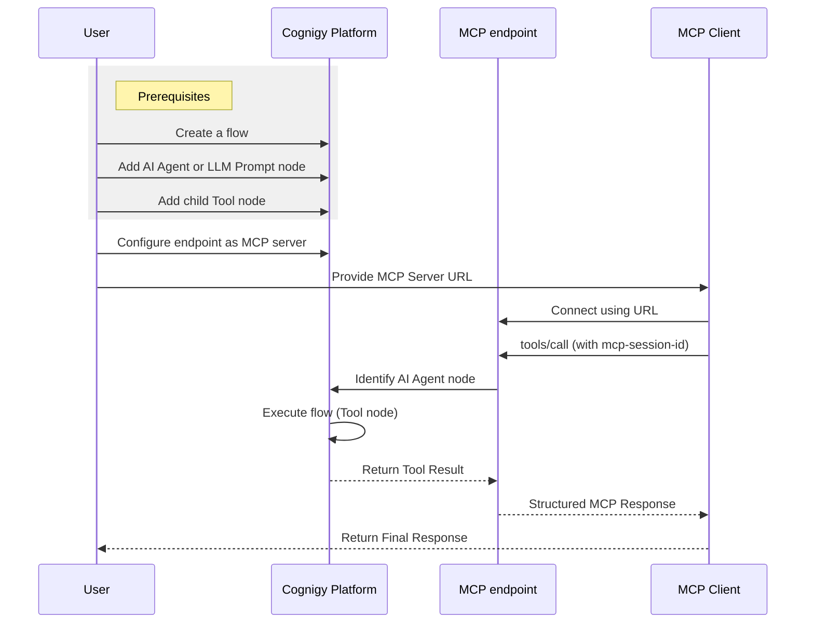

import A2aAndMcp from '/snippets/ai/a2a-and-mcp.mdx';


<Frame>
  
</Frame>

<Warning>
 The MCP server endpoint is experimental and isn't recommended for production use. This endpoint may change or be removed in future releases. Use it only in development or staging environments.
</Warning>

The MCP server endpoint allows external AI applications to use tools from an agent in Cognigy via the Model Context Protocol (MCP). Compatible clients, such as desktop AI assistants or custom MCP applications, can discover and execute these tools.

Unlike standard endpoints, the MCP server endpoint isn't designed for conversational use. It doesn't use NLU, process user messages, or perform real-time translation. Instead, it works as a tool server: clients discover the available tools and invoke them using structured requests. Cognigy then executes the corresponding flow logic and returns the results through MCP.

## Key benefits

- **Tool access through MCP**. Tools configured under an [AI Agent](/ai/agents/overview) or [LLM Prompt](/ai/agents/develop/node-reference/service/llm-prompt) node are available to MCP-compatible clients.
- **Direct flow execution**. When a tool is called, Cognigy executes the related flow and returns the result through MCP.
- **Standard integration**. MCP provides a consistent interface for connecting external applications without custom APIs.

## Restrictions

- The following tools are available via MCP:
   - Regular Tool
   - Knowledge Search
   - Send Email
   - Execute Workflow
   - Handover to agent
- Tool calls must finish within the configured timeout. The default timeout is 30 seconds. If you have an on-premises installation, you can change the default value using the `MCP_SERVER_TOOL_CALL_TIMEOUT` variable.
- This endpoint supports OAuth 2.0 or no authentication. User-level authentication isn't supported.

## Prerequisites

- A flow that contains an AI Agent node or an LLM Prompt node.
- The AI Agent node or LLM Prompt node in the flow must include at least one Tool node.
  - Each Tool node must have a tool ID and a description.

## Generic endpoint settings

Learn about the generic endpoint settings on the following pages:

- [Endpoints overview](/ai/agents/deploy/endpoints/overview)
- [Data protection & analytics](/ai/agents/deploy/endpoints/data-protection-and-analytics)
- [Transformer functions](/ai/for-developers/transformers/overview)

## Endpoint-specific settings

### Setup tab

#### AI agent selection

Use this section to select the flow and the AI Agent or LLM Prompt node whose tools are exposed via the Model Context Protocol (MCP). External AI clients can discover and call these tools through this endpoint.

| Parameter | Type | Description |
| --------- | ---- | ----------- |
| Flow | List     | Sets the flow that contains the AI Agent or LLM Prompt node. |
| AI Agent Node | List     | Sets the AI Agent or LLM Prompt node whose child Tool nodes are exposed via MCP. Only tools defined as children of the selected node are exposed to MCP clients. |
| Exposed Tools | Cards | Displays all tools exposed by the selected node. |

#### MCP server

| Parameter | Type | Description |
| --------- | ---- | ----------- |
| Enable MCP Server | Toggle | Activates the MCP server for the endpoint. |

#### Integration

This section provides the information required to configure MCP clients: the MCP Server URL and a link to the MCP explorer, where you can view all exposed tools, including their names, descriptions, and parameters.

| Parameter | Type | Description |
| --------- | ---- | ----------- |
| MCP Server URL | Text   | Provides the dedicated MCP URL in the format `https://endpoint.cognigy.ai/mcp/v1/{token}/mcp`. This is the single entry point for all MCP traffic. Keep the URL confidential. |
| Open MCP Explorer | Button | Opens the MCP explorer, where you can test your tools and view connection details. The MCP explorer displays all exposed tools, including their names, descriptions, and parameters. It also provides ready-to-use configuration snippets for Claude Desktop and Cursor, with a server key based on the endpoint name. |

### Advanced tab

#### Authentication

| Parameter | Type | Description |
| --------- | ---- | ----------- |
| Authentication Type | List     | Sets how external AI clients authenticate when they call the endpoint. You can select the following options:<ul><li>**No Auth** — the endpoint accepts requests without authentication.</li><li>**OAuth 2.0** — the endpoint accepts only requests with a valid OAuth 2.0 access token.</li></ul> |
| JWKS URI | Text   | This parameter appears only if you select **OAuth 2.0**. Sets the HTTPS URL of the JSON Web Key Set from your OAuth identity provider. Cognigy uses it to verify token signatures and never stores tokens. |
| Issuer | Text   | This parameter appears only if you select **OAuth 2.0**. Sets the issuer of the tokens. |
| Audience | Text   | This parameter appears only if you select **OAuth 2.0**. Sets the audience the tokens are issued for. |
| Required Scopes | Text   | This parameter appears only if you select **OAuth 2.0**. Sets a comma-separated list of scopes. Tokens must include all of these scopes. |
| Allowed Subject IDs | Text   | This parameter appears only if you select **OAuth 2.0**. This parameter is optional. Sets a comma-separated list of subject IDs. Leave the field empty to allow any subject. To restrict access, add the IDs of the callers you want to allow. |
| Key Refresh Interval (minutes) | Number | This parameter appears only if you select **OAuth 2.0**. This parameter is optional. Sets how often Cognigy refreshes signing keys from your identity provider. The value must be between 1 and 1440 minutes. The default value is `60`. |

## How to set up

The diagram shows the complete MCP workflow. First, make sure your flow is set up correctly with an AI Agent or LLM Prompt node and a Tool node, according to the prerequisites. Then, the MCP client connects to the MCP server endpoint and calls a tool. This triggers the flow execution. The result is returned through a session-based connection.



### Configure in Cognigy

<Accordion title="Configure MCP server endpoint">
   1. In the left-side menu of your project, click **Deploy > Endpoints**.
   2. On the **Endpoints** page, click **+ New Endpoint**.
   3. In the **New Endpoint** dialog, select the **MCP Server** endpoint type and click **Create endpoint**.
   4. On the **Setup** tab, configure the following:
       **Endpoint name** — enter a unique name.
       **AI Agent Selection** — select the flow and the AI Agent node or LLM Prompt node for which you want to expose the tools via MCP. Save changes.
   5. In the **Integration** section, copy the URL in the **MCP Server URL** field.
   6. In the **MCP server** section, activate the **Enable MCP Server** toggle to start the server and allow clients to connect.
   7. On the **Advanced** tab, in the **Authentication** section, select the authentication method for the MCP server from the **Authentication Type** list:
        - **No Auth** — no authentication is required to access the MCP server. Use this option for internal or trusted environments only. The option is selected by default.
        - **OAuth 2.0** — activate token-based authentication using OAuth 2.0. Use this option to verify that only authorized clients can access the MCP server. Configure the following fields:
          - **JWKS URI** — the URL of the JSON Web Key Set (JWKS) endpoint used to verify token signatures. You can find this URL in your identity provider's OpenID Connect discovery document, typically at `/.well-known/openid-configuration`. For example, `https://your-idp.example.com/.well-known/jwks.json`.
          - **Issuer** — the expected token issuer. This value must match the `iss` claim in the JWT. You can find this value in your identity provider's app settings, often labeled **Issuer URL** or **Authority**. For example, `https://your-idp.example.com`.
          - **Audience** — the intended recipient of the token. This value must match the `aud` claim in the JWT. Use a value from your identity provider, such as the client ID or a custom API identifier. For example, `cognigy-mcp-client`.
          - **Required Scopes** — the OAuth scopes that the token must include to be granted access. Define these scopes in your identity provider when configuring the application or API permissions. For example, `cognigy:mcp`.
          - **Allowed Subject IDs** — optional. Enter a comma-separated list of subject identifiers (`sub` claim) permitted to access the server. You can find the subject ID in the JWT payload or in your identity provider's user or service account settings. For example, `user-123, service-account-456`. If the field is empty, all subjects are allowed.
          - **Key Refresh Interval (minutes)** — optional. Enter how often the JWKS public keys are refreshed, in minutes. Increase this value to reduce the number of requests to your identity provider. Must be a value between `1` and `1440`, for example, `120`. If you leave this parameter empty, the server uses the default interval of 60 minutes.
</Accordion>

### Configure in the third-party provider

<Accordion title="Configure MCP client">

  The configuration depends on the MCP client you use.

<Tabs>
  <Tab title="Direct HTTP integration">
   The MCP server endpoint supports the MCP Streamable HTTP transport. To integrate directly with the endpoint, follow these steps:

   1. Send an `initialize` request.

       ```bash
       curl -i -X POST https://endpoint-dev.cognigy.ai/mcp/v1/{token}/mcp \
         -H "Content-Type: application/json" \
         -d '{
           "jsonrpc": "2.0",
           "id": 1,
           "method": "initialize",
           "params": {
             "protocolVersion": "2024-11-05",
             "capabilities": {},
             "clientInfo": {
               "name": "test",
               "version": "1.0"
             }
           }
         }'
       ```
       Replace `{token}` with the token from the MCP Server URL.

   2. The response includes `mcp-session-id: <session-id>`. Store the session ID for use in subsequent requests.
   3. Request a list of available tools via `tools/list`:

       ```bash
       curl -X POST https://endpoint-dev.cognigy.ai/mcp/v1/{token}/mcp \
         -H "Content-Type: application/json" \
         -H "mcp-session-id: <session-id>" \
         -d '{
           "jsonrpc": "2.0",
           "id": 2,
           "method": "tools/list"
         }'
       ```

      The request returns the list of available tools with their parameters and descriptions. This allows the client to understand how to call each tool correctly.

      For example, the response may include tools like this:

      ```json
      {
        "jsonrpc": "2.0",
        "id": 2,
        "result": {
          "tools": [
            {
              "name": "mcp",
              "description": "",
              "inputSchema": {
                "type": "object",
                "properties": {},
                "required": []
              }
            },
            {
              "name": "SearchCognigyDocumentation",
              "description": "",
              "inputSchema": {
                "type": "object",
                "properties": {},
                "required": []
              }
            },
            {
              "name": "unlock_account",
              "description": "This tool unlocks a locked user account.",
              "inputSchema": {
                "type": "object",
                "properties": {
                  "email": {
                    "type": "string",
                    "description": "User's login email for their account."
                  }
                },
                "required": ["email"]
              }
            }
          ]
        }
      }
      ```

   4. Call tools using the `tools/call` method, providing the tool name and required arguments.
       For example, to call the `unlock_account` tool with the required `email` argument, send the following request:

       ```bash
       curl -X POST https://endpoint-dev.cognigy.ai/mcp/v1/{token}/mcp \
         -H "Content-Type: application/json" \
         -H "mcp-session-id: <session-id>" \
         -d '{
           "jsonrpc": "2.0",
           "id": 3,
           "method": "tools/call",
           "params": {
             "name": "unlock_account",
             "arguments": {
               "email": "user@example.com"
             }
           }
         }'
       ```

       After a successful tool call, the MCP server returns the result in a structured MCP response. The response contains the output of the executed tool inside the `result` field. For example, if the tool completes successfully, it may return a text message such as `Resolved` in the `content` array.

       ```json
       {
         "jsonrpc": "2.0",
         "id": 3,
         "result": {
           "content": [
             {
               "type": "text",
               "text": "Resolved"
             }
           ]
         }
       }
       ```
    </Tab>
     <Tab title="Claude Desktop">
      To configure the MCP client in Claude Desktop, follow these steps:

      1. In the Claude Desktop application, go to **Settings > Developer > Local MCP servers**. Click **Edit Config**.
      2. Add the following configuration to `claude_desktop_config.json`:

        ```json
        {
          "mcpServers": {
            "my-endpoint-name": {
              "command": "npx",
              "args": [
                "mcp-remote",
                "https://endpoint.cognigy.ai/mcp/v1/{token}/mcp"
              ]
            }
          }
        }
        ```
         Replace `{token}` with the token from the MCP Server URL and `my-endpoint-name` with a name for your endpoint. The MCP explorer automatically generates a key based on the endpoint name.

      3. Close and reopen Claude Desktop. It automatically launches `mcp-remote`, connects to the MCP server, initializes the session, and loads the available tools.
      4. In Claude Desktop, open the chat and ask the AI to perform a task that requires a tool. Claude Desktop automatically calls the appropriate MCP tool when needed.

      </Tab>
      <Tab title="Cursor">
        To configure the MCP client in Cursor, follow these steps:

        1. In the root directory of your Cursor project, create the `.cursor/mcp.json` file. If the `.cursor` folder doesn't exist, create it manually.
        2. Add the following configuration to the `mcp.json` file:

            ```json
            {
              "mcpServers": {
                "my-endpoint-name": {
                  "command": "npx",
                  "args": [
                    "-y",
                    "mcp-remote",
                    "https://endpoint.cognigy.ai/mcp/v1/{token}/mcp"
                  ]
                }
              }
            }
            ```
            The `-y` flag lets `npx` run the package without asking for confirmation. Replace `{token}` with the token from the MCP Server URL and `my-endpoint-name` with a name for your endpoint. The MCP explorer automatically generates a key based on the endpoint name.

        3. Close and reopen Cursor. It automatically launches `mcp-remote`, connects to the MCP server, initializes the session, and loads the available tools.
        4. Open the Cursor Chat in Agent mode. Ask the AI to perform a task that requires a tool. Cursor automatically calls the appropriate MCP tool when needed.
      </Tab>
  </Tabs>
</Accordion>

## Use cases

<AccordionGroup>
  <Accordion title="Access knowledge bases">
    External AI clients can use MCP to query Cognigy knowledge bases through the Knowledge Search Tool.
    This approach enables real-time retrieval of relevant content, such as product information, policies, or support articles,
    directly from connected applications.
  </Accordion>

  <Accordion title="Automate business tasks">
    MCP clients can trigger operational workflows, such as CRM lookups, ticket creation, or email notifications.
    When a tool is called, the corresponding flow is executed, allowing existing business logic to run
    without modification.
  </Accordion>

  <Accordion title="Expose internal logic">
    Existing flows can be published as callable tools. This approach allows organizations to reuse and expose
    internal automation, decision logic, and agent configurations as standardized tools
    available to external systems.
  </Accordion>

  <Accordion title="Connect custom applications">
    Custom AI applications, development environments, or third-party systems can integrate with Cognigy
    through the MCP. This approach enables structured tool calls and consistent result handling
    without building and maintaining custom APIs.
  </Accordion>
</AccordionGroup>

## Troubleshooting

| **Issue**           | **Cause**                                                                                                                             | **Solution**                                                                                                                                                                        |
| ------------------- | ------------------------------------------------------------------------------------------------------------------------------------- | ----------------------------------------------------------------------------------------------------------------------------------------------------------------------------------- |
| Tools not visible   | The AI Agent or LLM Prompt node doesn't contain Tool nodes, or tools are missing a tool ID or description. The wrong flow or node may be selected. | Ensure the AI Agent or LLM Prompt node includes Tool nodes. Verify that each tool has a tool ID and description. Confirm the correct flow and node are selected in the endpoint settings. |
| Tool call times out | The tool execution exceeds the default 30-second timeout.                                                                          | If you have an on-premises installation, change the `MCP_SERVER_TOOL_CALL_TIMEOUT` variable if a longer execution time is required.                                                                                     |
| Connection fails    | The full MCP URL isn't specified, or an incorrect path is configured.                                                                     | Ensure you use the complete URL in the format `/mcp/v1/{token}/mcp`. The endpoint doesn't respond on other paths.                                                            |
| Session expired     | The MCP session has timed out due to inactivity.                                                                                      | Reinitialize the session by sending a new `initialize` request without a session ID.                                                                                                |
| Authentication failed                                    | The Bearer token is missing, expired, or doesn't include the required scopes.                    | Verify that the token is valid and includes the scopes configured in the **Required Scopes** field. Re-authenticate if the token has expired.                                                                                      |
| The **Run Test** button in the MCP explorer isn't active | A reverse proxy or security layer is changing the Content Security Policy (CSP) headers set by the MCP explorer page. | The MCP explorer sets its own CSP headers using nonce-based script allowlisting. Make sure upstream proxies or security tools don't remove or change these headers. Contact your platform administrator if CSP changes are needed. |

## MCP compared to A2A

<A2aAndMcp />

## More information

- [Endpoints overview](/ai/agents/deploy/endpoints/overview)
