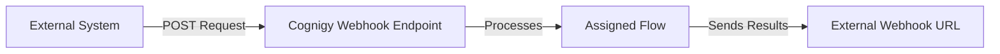

import ApiKeyAuthSettings from '/snippets/ai/deploy/endpoint/api-key-auth-settings.mdx'


<Frame>
  
</Frame>

The Webhook endpoint connects your agent to external systems by sending real-time events, such as user or system messages, to a specified callback (webhook) URL. Additionally, you can configure API key-based authentication for requests to this endpoint.

The endpoint receives `POST` requests at the Cognigy endpoint URL, processes them with the assigned flow, and sends results asynchronously to your webhook URL.



If you use [Agent Copilot for voice](/agent-copilot/getting-started/voice) with the Webhook endpoint, you can switch to a specific [Voice Copilot](/ai/agents/deploy/endpoint-reference/voice-copilot) endpoint. This endpoint includes all webhook logic, so you don't need to use a Code node.

## Prerequisites

- To receive `POST` requests from Cognigy at your webhook URL, run a web server on your side.
- _(Optional)_ Set up basic authentication for your web server.

## Restrictions

- [Snapshots](/ai/agents/deploy/snapshots) and [packages](/ai/agents/deploy/packages) don't support API keys generated in this endpoint. If you export a Webhook endpoint that includes an API key, generate a new API key in the target project. Then update your code to include the new API key.

## Generic endpoint settings

Learn about the generic endpoint settings on the following pages:

- [Endpoints overview](/ai/agents/deploy/endpoints/overview)
- [NLU connectors](/ai/platform-features/nlu/external/nlu-connectors/overview)
- [Data protection & analytics](/ai/agents/deploy/endpoints/data-protection-and-analytics)
- [Real-time translation](/ai/agents/deploy/endpoints/real-time-translation-settings)
- [Inject and Notify](/ai/agents/deploy/endpoints/inject-and-notify)
- [Copilot](/agent-copilot/configure/copilot-section)

## Endpoint-specific settings

### Advanced tab

#### Basic auth credentials

Use this section to provide the webhook URL and, optionally, credentials Cognigy uses to authenticate outgoing requests to the webhook URL.

| Parameter | Type | Description                                                                                                     |
| --------- | ---- | --------------------------------------------------------------------------------------------------------------- |
| User      | Text | This parameter is optional. Sets the username to authenticate against when sending requests to the webhook URL. |
| Password  | Text | This parameter is optional. Sets the password to authenticate against when sending requests to the webhook URL. |
| Webhook URL | Text | Sets the webhook URL to send requests to.                                                                       |

#### API key authentication

<ApiKeyAuthSettings />

## How to set up

### Configure in Cognigy

<Accordion title="Create a webhook endpoint">
  1. In the left-side menu of your project, go to **Deploy > Endpoints**, and click **+ New Endpoint**.
  2. In the **New Endpoint** dialog, select the **Webhook** endpoint type and click **Create endpoint**.
  3. On the **Setup** tab, configure the following:
      **Endpoint name** — enter a unique name.
      **Target type** — select an agent or flow from the list. Save changes.
  4. _(Optional)_ To set up endpoint-specific API authentication, go to the **Advanced** tab and activate the **Require API Key** setting in the **API Key Authentication** section. The **Endpoint API keys** section appears. Follow these steps:
      1. Click **Generate API Key**.
      2. In the dialog box, enter a unique name for your API key in the **Key name** field and click **Generate API Key**.
      3. Click the **Key** field to copy the generated API key for later use in the header of requests to the endpoint URL. Save the API key because you can't retrieve it after closing the dialog. Alternatively, you can create and manage API keys for this endpoint using the `/v2.0/endpoints/{endpointId}/apikeys` routes via [Cognigy API](https://api-trial.cognigy.ai/openapi#tag--Endpoints).
  5. On the **Advanced** tab, in the **Basic Auth Credentials** section, enter the external webhook URL in the **Webhook URL** field. This URL is where Cognigy sends output data.
  6. _(Optional)_ If your webhook uses basic authentication, fill in the **User** and **Password** fields.
  7. Save changes. Then, on the **Setup** tab, in the **Integration** section, copy the URL from the **Endpoint URL** field. Use this URL to send `POST` requests to the Cognigy Webhook endpoint.
</Accordion>

### Configure in the third-party provider

<AccordionGroup>
  <Accordion title="1. Send a request">

    Send a `POST` request to the Cognigy Webhook endpoint. Your web server must accept `POST` requests and process the JSON payload sent by Cognigy. For testing purposes, you can use [webhook.site](https://webhook.site) as a temporary web server.

    <AccordionGroup>
      <Accordion title="No authentication">

        <Tabs>
          <Tab title="cURL">
            Replace `https://<your-endpoint-url>` with the endpoint URL from the endpoint settings.

            ```bash
            curl -X POST https://<your-endpoint-url> \
              -H "Content-Type: application/json" \
              -d '{
                "userId": "user123",
                "sessionId": "session123",
                "text": "Hello, I need help with my order",
                "data": {
                  "exampleKey": "exampleValue"
                }
              }'
            ```
          </Tab>
          <Tab title="Postman">
            1. Open the Postman collection, select **Add a request**, then set the request type to `POST`.
            2. Enter the endpoint URL as the request URL.
            3. Go to the **Headers** tab and add `Content-Type: application/json`.
            4. Go to the **Body** tab, select **raw**, then select **JSON** as the format.
            5. Paste the request body:

            ```json
            {
              "userId": "user123",
              "sessionId": "session123",
              "text": "Hello, I need help with my order",
              "data": {
                "exampleKey": "exampleValue"
              }
            }
            ```

            | Parameter | Type   | Description                                                                                                                                                                                                 | Required                                             |
            | --------- | ------ | ----------------------------------------------------------------------------------------------------------------------------------------------------------------------------------------------------------- | ---------------------------------------------------- |
            | userId    | String | The ID of the end user.                                                                                                                                                                                     | Yes                                                  |
            | sessionId | String | The ID used to track the current session and maintain its state. Generate a new unique ID for each new session. For testing, you can use any string and change it whenever you want to start a new session. | Yes                                                  |
            | text      | String | The text that the assigned flow processes.                                                                                                                                                                  | No, if `data` is specified<sup>[1](#footnote1)</sup> |
            | data      | Object | The data that the assigned flow processes.                                                                                                                                                                  | No, if `text` is specified<sup>[1](#footnote1)</sup> |
          </Tab>
        </Tabs>

      </Accordion>
      <Accordion title="With API key authentication">

        The API key authentication header name depends on your Cognigy version.

        <AccordionGroup>
          <Accordion title="For Cognigy 2026.16.0 and later version">

            Use the `x-cognigy-endpoint-key` header. The endpoint also accepts the legacy `X-Webhook-Key` header for backward compatibility, but `x-cognigy-endpoint-key` takes precedence if both are provided.

            <Tabs>
              <Tab title="cURL">
                Replace `https://<your-endpoint-url>` with the endpoint URL and `<your-api-key>` with an active API key from the endpoint settings.

                ```bash
                curl -X POST https://<your-endpoint-url> \
                  -H "Content-Type: application/json" \
                  -H "x-cognigy-endpoint-key: <your-api-key>" \
                  -d '{
                    "userId": "user123",
                    "sessionId": "session123",
                    "text": "Hello, I need help with my order",
                    "data": {
                      "exampleKey": "exampleValue"
                    }
                  }'
                ```
              </Tab>
              <Tab title="Postman">
                1. Open the Postman collection, select **Add a request**, then set the request type to `POST`.
                2. Enter the endpoint URL as the request URL.
                3. Go to the **Headers** tab and configure:
                    - `Content-Type` — select `application/json`
                    - `x-cognigy-endpoint-key` — the API key you generated in the [API Key Authentication](#api-key-authentication) section.
                4. Go to the **Body** tab, select **raw**, then select **JSON** as the format.
                5. Paste the request body:

                ```json
                {
                  "userId": "user123",
                  "sessionId": "session123",
                  "text": "Hello, I need help with my order",
                  "data": {
                    "exampleKey": "exampleValue"
                  }
                }
                ```

                | Parameter | Type   | Description                                                                                                                                                                                                 | Required                                             |
                | --------- | ------ | ----------------------------------------------------------------------------------------------------------------------------------------------------------------------------------------------------------- | ---------------------------------------------------- |
                | userId    | String | The ID of the end user.                                                                                                                                                                                     | Yes                                                  |
                | sessionId | String | The ID used to track the current session and maintain its state. Generate a new unique ID for each new session. For testing, you can use any string and change it whenever you want to start a new session. | Yes                                                  |
                | text      | String | The text that the assigned flow processes.                                                                                                                                                                  | No, if `data` is specified<sup>[1](#footnote1)</sup> |
                | data      | Object | The data that the assigned flow processes.                                                                                                                                                                  | No, if `text` is specified<sup>[1](#footnote1)</sup> |
              </Tab>
            </Tabs>
          </Accordion>
          <Accordion title="For Cognigy 2026.13 to 2026.15">
            <Tabs>
              <Tab title="cURL">
                Replace `https://<your-endpoint-url>` with the endpoint URL and `<your-api-key>` with an active API key from the endpoint settings.

                ```bash
                curl -X POST https://<your-endpoint-url> \
                  -H "Content-Type: application/json" \
                  -H "X-Webhook-Key: <your-api-key>" \
                  -d '{
                    "userId": "user123",
                    "sessionId": "session123",
                    "text": "Hello, I need help with my order",
                    "data": {
                      "exampleKey": "exampleValue"
                    }
                  }'
                ```
              </Tab>
              <Tab title="Postman">
                1. Open the Postman collection, select **Add a request**, then set the request type to `POST`.
                2. Enter the endpoint URL as the request URL.
                3. Go to the **Headers** tab and configure:
                    - `Content-Type` — select `application/json`
                    - `X-Webhook-Key` — the API key you generated in the [API Key Authentication](#api-key-authentication) section.
                4. Go to the **Body** tab, select **raw**, then select **JSON** as the format.
                5. Paste the request body:

                ```json
                {
                  "userId": "user123",
                  "sessionId": "session123",
                  "text": "Hello, I need help with my order",
                  "data": {
                    "exampleKey": "exampleValue"
                  }
                }
                ```

                | Parameter | Type   | Description                                                                                                                                                                                                 | Required                                             |
                | --------- | ------ | ----------------------------------------------------------------------------------------------------------------------------------------------------------------------------------------------------------- | ---------------------------------------------------- |
                | userId    | String | The ID of the end user.                                                                                                                                                                                     | Yes                                                  |
                | sessionId | String | The ID used to track the current session and maintain its state. Generate a new unique ID for each new session. For testing, you can use any string and change it whenever you want to start a new session. | Yes                                                  |
                | text      | String | The text that the assigned flow processes.                                                                                                                                                                  | No, if `data` is specified<sup>[1](#footnote1)</sup> |
                | data      | Object | The data that the assigned flow processes.                                                                                                                                                                  | No, if `text` is specified<sup>[1](#footnote1)</sup> |
              </Tab>
            </Tabs>
          </Accordion>
        </AccordionGroup>

      </Accordion>
    </AccordionGroup>

  </Accordion>

  <Accordion title="2. Get a response">

    The Webhook endpoint sends the following JSON response to your external system. This response contains information about the user, session, and the agent output:

      ```JSON
      {
         "userId": "user123",
         "sessionId": "session123",
         "AIOutput": {
            "text": "I’d be happy to help. Could you please provide your order number?",
            "data": {},
            "traceId": "endpoint-httpIncomingMessage-83b52cb7-1452-4c2d-a57d-4a81e6adb92c",
            "disableSensitiveLogging": false,
            "source": "bot"
         }
      }
      ```

    | Parameter                 | Type    | Description                                                                                                                             |
    | ------------------------- | ------- | --------------------------------------------------------------------------------------------------------------------------------------- |
    | `userId`                  | String  | The ID of the user who sent the original request.                                                                                       |
    | `sessionId`               | String  | The session ID used to track the conversation context.                                                                                  |
    | `AIOutput.text`           | String  | The response message generated by the agent.                                                                                         |
    | `AIOutput.data`           | Object  | The message data returned from the flow.                                                                                                |
    | `AIOutput.traceId`        | String  | The ID used for tracing and debugging purposes.                                                                                         |
    | `AIOutput.source`         | String  | The message source. Always `"bot"` for agent replies.                                                                                |
    | `disableSensitiveLogging` | Boolean | The flag indicating if logging is disabled. If the value is `true`, this interaction won't be logged for privacy or compliance reasons. |
  </Accordion>
</AccordionGroup>

## More information

- [Endpoints overview](/ai/agents/deploy/endpoints/overview)

---
<sup id="footnote1">1</sup>: You must provide at least one of `text` or `data`. You can send either, or both. If both are missing or invalid, the Webhook endpoint throws an error.
